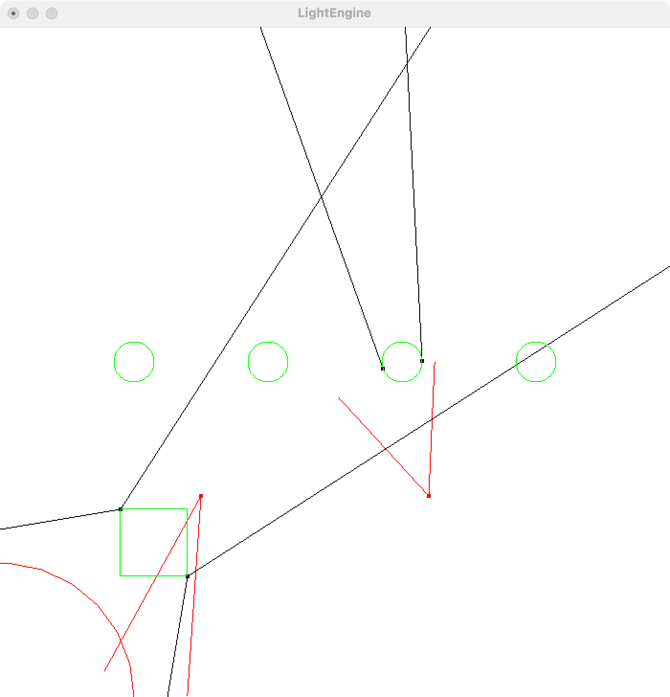

# 2D Light Engine (OpenGL)

A small 2D lighting and shadow-casting experiment in C++ with legacy OpenGL and GLUT.
I wrote it at school in 2011. It's a pet project, not a library.

The engine takes a scene of polygons and circles plus a few lights. For every light it finds the
**silhouette points** of each object the light reaches and casts **shadow rays** from them.
It draws all of this as a debug overlay (wireframes, points, rays). It doesn't fill shadows yet.



Video of it running: https://youtu.be/uH2JnOpf_E4

## Quick start

### Requirements

| Platform | What to install |
| --- | --- |
| macOS | Xcode Command Line Tools: `xcode-select --install`. OpenGL and GLUT ship with macOS. |
| Debian / Ubuntu | `sudo apt install build-essential freeglut3-dev` |
| Fedora | `sudo dnf install gcc-c++ make freeglut-devel` |

Any C++98-or-newer compiler works. The code uses only the standard library, OpenGL 1.x and GLUT.

### Build and run

```sh
git clone https://github.com/edgarMeinart/opengl-2d-light-example.git
cd opengl-2d-light-example
make run
```

| Command | What it does |
| --- | --- |
| `make` | Builds `build/LightEngine` |
| `make run` | Builds, then starts the demo from the repo root |
| `make clean` | Removes `build/` |

The scene is loaded from `data/map.txt` relative to the **current directory**. Run the binary from the
repo root (`make run` does this for you). Started from anywhere else, it exits with
`data/map.txt (run from the repository root): No such file or directory`.

You can change the compiler or flags the usual way, e.g. `make CXX=clang++ CXXFLAGS="-O0 -g"`.
Header dependencies are tracked, so editing a header rebuilds only the files that include it.

### Controls

- **Hold a mouse button and drag** to move the lamp. It starts in the bottom-left corner.
- Close the window to quit.

## What you see

| Colour | Meaning |
| --- | --- |
| Green | Occluders: polygons and circles from `data/map.txt` |
| Red point + circle | Lamp (omnidirectional light) and its radius |
| Red point + two lines | Flashlight (cone light) and the edges of its cone |
| Black points + lines | Silhouette points found on occluders and the shadow rays cast from them |

The demo scene has three lights:

- **Lamp:** the first light in `data/map.txt`. It follows the mouse while you drag.
- **Rotating flashlight** at `(15, 15)`, 25° cone, turns slowly.
- **Static flashlight** at `(32, 15)`, pointing at 110° with a 45° cone.

## How it works

The world is a 50×50-unit orthographic space (`glOrtho(0, 50, 0, 50, …)`) drawn in a 700×700 window.
Every 15 ms (`Timer` in `src/main.cpp`) the engine:

1. **Broad phase** (`LightSystem::CheckLightPosition`). Tests each light's AABB against each object's
   AABB. A lamp's box is its position ± radius. A flashlight's box covers its cone triangle. Objects
   that overlap are stored in `leLight::objID`.
2. **Polygon silhouettes** (`GetEdgeFromPolygon`, `VertexIsEdge`). For each vertex, the light vector
   `L = light − v` is dotted with the normals of the two edges that meet at the vertex. If the two dot
   products have opposite signs, one edge faces the light and the other faces away, so the vertex is
   on the silhouette. The first two such vertices become a `leEdge`.
3. **Circle silhouettes** (`LightSystem::FindEdges`). Computes the two tangent points from the light
   to the circle. With distance `d` to the centre and radius `r`, the tangent length is
   `√(d² − r²)` and the half-angle is `asin(r / d)` around the direction to the centre.
4. **Shadow rays** (`leEdge`). Pushes each silhouette point away from the light,
   `v + (v − light) · k`, to get the far end of the shadow boundary.

`src/le/leOpenGLRender.cpp` also has unused helpers for filled shadows: `DrawGLLight` (a
radial-gradient light disc) and `DrawGLQuad` (a shadow quad). The window also asks for a stencil
buffer. That was the next step and it never got finished.

## Project structure

```
.
├── Makefile
├── data/
│   └── map.txt              Demo scene
├── docs/
│   └── screenshot.png
└── src/
    ├── main.cpp             GLUT window, map loader, update loop, debug drawing
    └── le/                  "Light engine"
        ├── leGL.h           Platform OpenGL/GLUT includes
        ├── leMath.*         leVec2f, leEdge, leAABB, dot(), degree→radian
        ├── lePoly2D.*       lePoly2D (polygon) and leEllipse2D (circle) occluders
        ├── leLight.*        leLight: lamp (le_llight) and flashlight (le_flight)
        ├── LightSystem.*    Scene container, broad phase, silhouette/edge search
        └── leOpenGLRender.* Immediate-mode drawing helpers
```

## Map format

Lines starting with `/` and empty lines are skipped. The sections must come in this order:

```
Polygons <count>
Polygon <vertex count>
<x> <y>                      one line per vertex
...
Circle <count>
<x> <y> <radius>             one line per circle
Lights <count>
Light <x> <y> <radius> <intensity>
```

Coordinates are world units in the range `0..50`. Polygons must be **convex**: the silhouette search
only looks for two silhouette vertices. Lights in the map are always lamps. The two flashlights are
added in code at the end of `LoadWorld()` in `src/main.cpp`.

## Known limitations

These are left as they were in 2011:

- The mouse mapping assumes a 700 px window, so the lamp drifts away from the cursor after a resize.
- `leLight::Move` computes the flashlight cone's `y` from `Position.x`. This doesn't show for the
  rotating flashlight because it sits at `(15, 15)`.
- Each light gets one silhouette pair per polygon, so concave polygons give wrong shadows.
- A light inside a polygon or circle gives no or garbage edges.
- `Intensity` and `Sleep` on `leLight` are stored but not used.

## History

The project started in 2011 as a Visual C++ 2008 Express project for Windows with freeglut. In 2026
it was cleaned up into a portable layout: `src/` + `data/` + `Makefile`, with the MSVC-only headers,
precompiled-header boilerplate and build artefacts removed. The original Windows project files and
the 2011 debug build are still in the git history, at commit `2f88022` and earlier.
