# 2D Light Engine (OpenGL)

Dynamic 2D lights and shadows in C++ and OpenGL. It started in 2011 as a school project
(silhouette edges and shadow rays drawn as a debug view). It now has a full renderer: soft shadows
with real penumbrae, bump mapping, HDR glow and bloom, flickering lights, lasers, lightning, and a
start menu with ten interactive examples built with [Dear ImGui](https://github.com/ocornut/imgui).

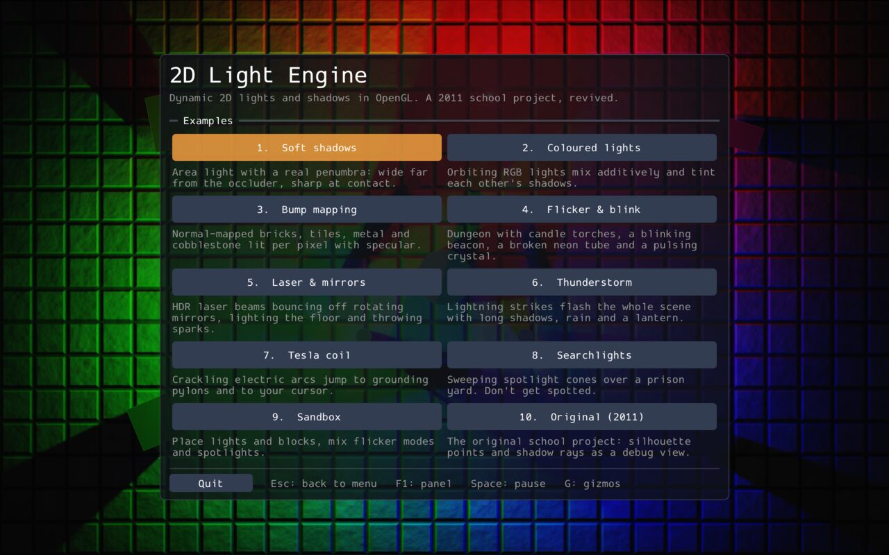

## Examples

| | |
| --- | --- |
| 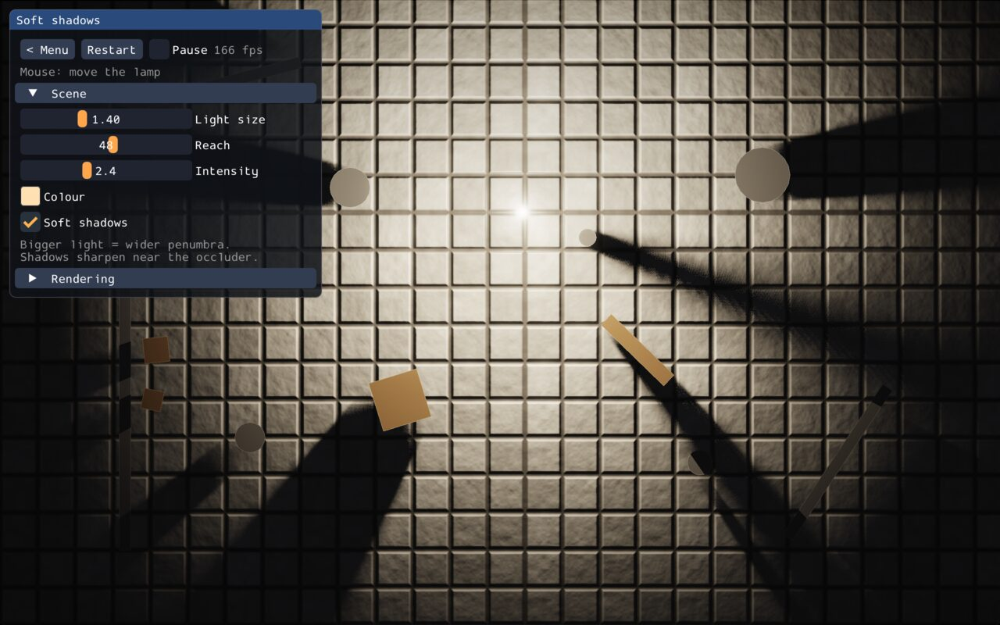 **Soft shadows**: area light with a real penumbra, wide far from the occluder and sharp at contact. | 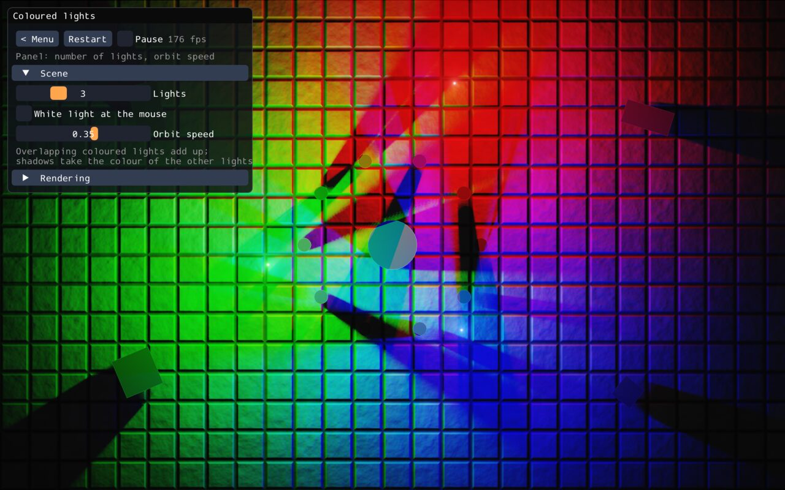 **Coloured lights**: orbiting RGB lights mix additively and tint each other's shadows. |
| 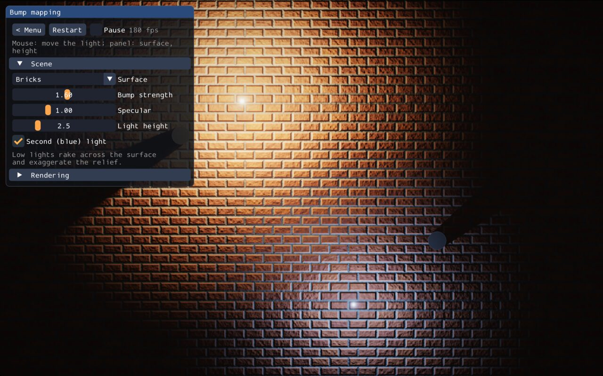 **Bump mapping**: normal-mapped bricks, tiles, metal and cobblestone with specular highlights. | 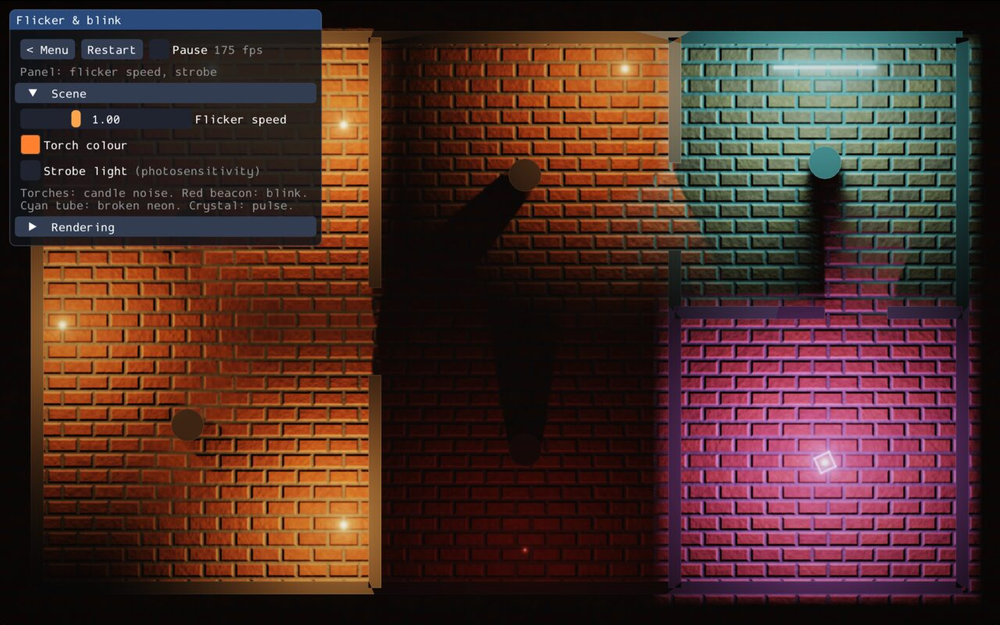 **Flicker & blink**: candle torches, a blinking beacon, a broken neon tube, a pulsing crystal. |
| 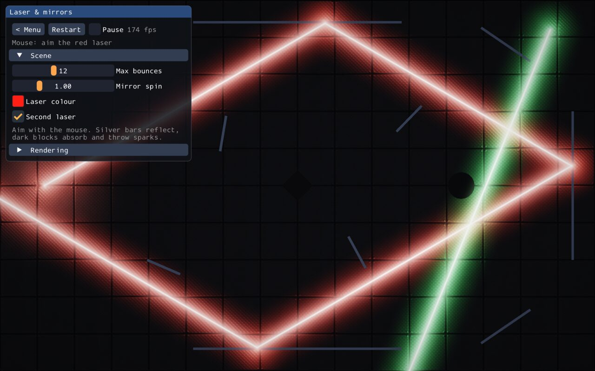 **Laser & mirrors**: HDR beams bounce off rotating mirrors, light the floor and throw sparks. | 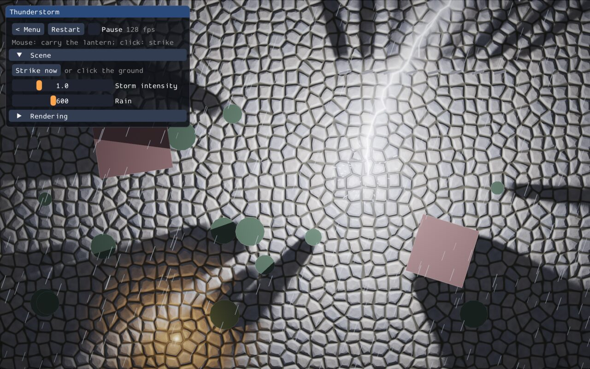 **Thunderstorm**: lightning flashes the scene with long shadows; rain and a lantern. |
| 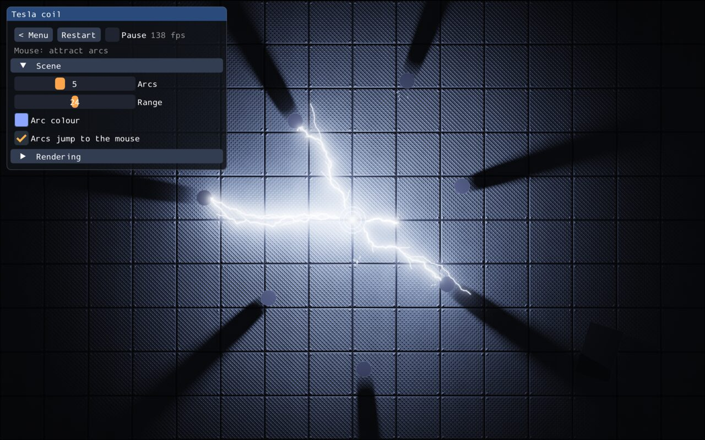 **Tesla coil**: electric arcs jump to grounding pylons and to the cursor. | 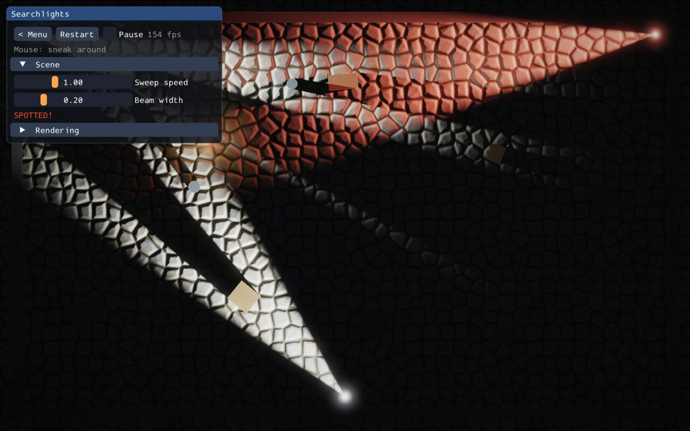 **Searchlights**: sweeping spotlight cones over a prison yard. Don't get spotted. |
| 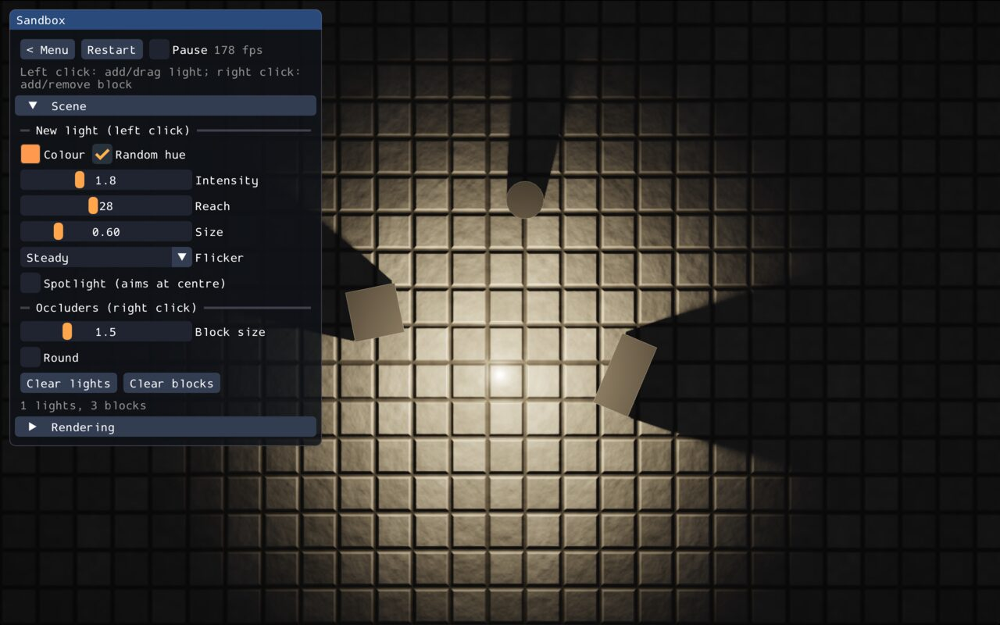 **Sandbox**: place lights and blocks, mix flicker modes and spotlights. | 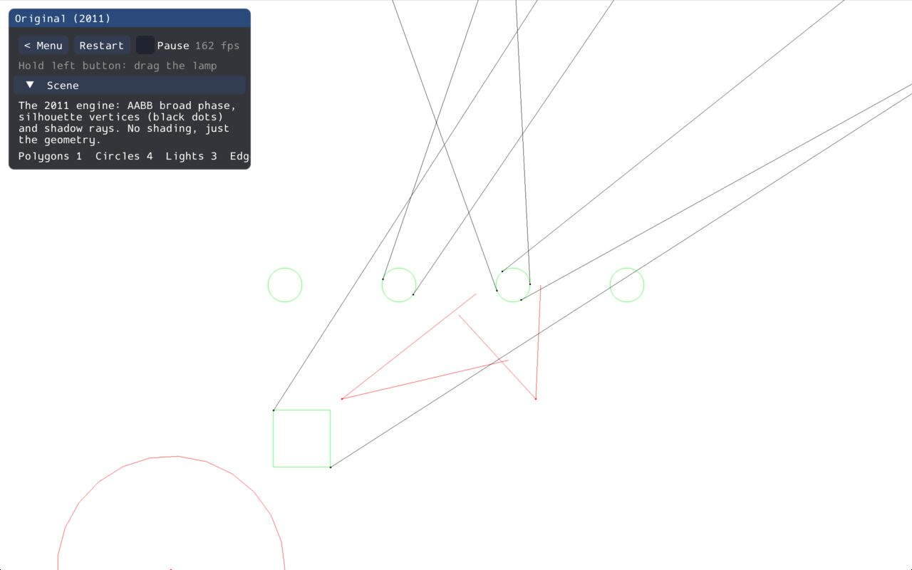 **Original (2011)**: the school project's silhouette points and shadow rays. |

Video of the 2011 version: https://youtu.be/uH2JnOpf_E4

## Quick start

### Requirements

- A C++17 compiler, `make` and `pkg-config`
- [GLFW 3](https://www.glfw.org/) (window, input, OpenGL context)
- OpenGL 2.1 with `EXT_framebuffer_object` and `ARB_texture_float` (any GPU from the last 15 years,
  or Mesa's software renderer)

Dear ImGui is vendored in `third_party/imgui`, so there's nothing else to install.

| Platform | Install |
| --- | --- |
| macOS | `xcode-select --install` and `brew install glfw pkg-config` |
| Debian / Ubuntu | `sudo apt install build-essential pkg-config libglfw3-dev` |
| Fedora | `sudo dnf install gcc-c++ make pkgconf glfw-devel` |

### Build and run

```sh
git clone https://github.com/edgarMeinart/opengl-2d-light-example.git
cd opengl-2d-light-example
make run
```

| Command | What it does |
| --- | --- |
| `make` | Builds `build/LightEngine` (`make -j8` for a parallel build) |
| `make run` | Builds, then starts the app from the repo root |
| `make clean` | Removes `build/` |
| `./build/LightEngine --list` | Lists the examples |
| `./build/LightEngine --example 5` | Skips the menu and opens example 5 |

Run the binary from the repo root. The *Original (2011)* example loads `data/map.txt` relative to the
current directory.

### Controls

| Key / mouse | Action |
| --- | --- |
| Click a button in the start menu | Open an example |
| `Esc` | Back to the menu (quits from the menu) |
| `F1` | Show or hide the settings panel |
| `Space` | Pause |
| `G` | Gizmos: light radii, cones, occluder outlines, line lights |
| Mouse | Per example, shown at the top of the panel (move the lamp, aim the laser, strike lightning…) |

Every example has a **Scene** section with its own controls. The **Rendering** section has the
global settings: shadows on/off, soft shadows, penumbra quality and scale, bump, specular, ambient,
exposure, bloom, vignette and light-buffer resolution.

## How it works

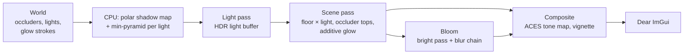

The renderer is OpenGL 2.1 with GLSL 1.20 shaders, EXT framebuffer objects and float textures
(`src/gfx/renderer.cpp`). Each frame:

1. **Polar shadow maps (CPU).** For every shadow-casting light, each occluder edge is rasterised
   into 1024 angular bins. A bin stores the distance to the nearest edge along that ray and the id
   of the occluder it hit. This is exact for any arrangement of edges, so overlapping occluders
   and concave groups of blocks cast correct shadows.
   A min-pyramid (10 levels, window radius 2^L − 1 bins) is built from the distances too.
2. **Light pass.** Every light is drawn as a quad into an `RGBA16F` light buffer with additive
   blending. Per pixel:
   - **Falloff**: windowed inverse-square.
   - **Spotlight cone** with a soft edge.
   - **Soft shadows**: the light is a disc of radius *size*. The shader takes several samples
     across the disc. For each one it marches the ray to the receiver through the polar map and
     marks it blocked where the ray crosses an occluder's front face. The visible fraction is the
     penumbra. Blockers near the light give wide penumbrae; blockers near the receiver give sharp
     contact shadows. Jittered samples turn banding into fine noise. The min-pyramid gives a
     conservative early-out: if no occluder is within reach of any sample, the pixel is fully lit
     and the march is skipped.
   - **Bump and specular**: the floor's tangent-space normal map against a light at `height`,
     plus a Blinn-Phong highlight stored in alpha.
   - **Line lights** (laser beams, arcs) use the distance to a segment and cast no shadows.
3. **Scene pass.**
   - **Floor**: the procedurally generated albedo × light buffer, plus specular.
   - **Occluder tops**: lit directly from the light list. A top is dark only where the shadow
     map says a *different* occluder is closer to the light, so blocks look solid.
   - **Glow**: beams, bolts, bulbs, sparks and rain are drawn last as additive HDR capsule
     strokes.
4. **Bloom and tone mapping.** A soft-knee bright pass at half resolution, then Gaussian blurs at
   1/4 and 1/8. These are added back before ACES tone mapping, vignette, gamma and dithering.

The effects on top of the renderer (`src/fx/effects.cpp`, `src/world/world.cpp`):

| Effect | How |
| --- | --- |
| Flicker | Per-light brightness patterns: candle (layered value noise with gusts), pulse (sine), blink (smoothed square wave), broken neon (random dropouts in bursts), strobe |
| Laser | Ray cast against occluder edges, reflected off `mirror` occluders up to N bounces. Glow strokes and line lights per segment, a flickering point light and sparks at the impact |
| Lightning | Midpoint displacement with random branches. Main stroke plus two return strokes, each a decaying flash with a shadow-casting point light and an ambient flash |
| Particles | Sparks as short velocity-aligned glow streaks that cool from white to the base colour |
| Floors | Tileable procedural height fields (tiles, bricks, metal tread plate with rivets, Voronoi cobblestone), turned into albedo and normal maps at startup |

## Project structure

```
.
├── Makefile
├── compile_flags.txt          clangd include paths
├── data/map.txt               Scene for the Original (2011) example
├── docs/screenshots/
├── src/
│   ├── main.cpp               GLFW window, OpenGL context, Dear ImGui setup, CLI flags
│   ├── app.{h,cpp}            Start menu, example lifecycle, input, settings panel
│   ├── core/math.h            Vec2/Vec3, RNG, value noise
│   ├── gfx/                   Renderer, shaders, render targets, procedural materials
│   ├── world/                 Lights, occluders, flicker patterns, ray casting
│   ├── fx/                    Particles, lightning bolts, laser tracing, rain
│   ├── examples/              The ten examples and their registry
│   └── le/                    The original 2011 engine (silhouettes + shadow rays)
└── third_party/imgui/         Dear ImGui v1.93.0 (core + GLFW and OpenGL2 backends)
```

To add an example, subclass `Example` (`src/examples/example.h`) and implement `setup()` and
`update()`, plus `ui()` for panel controls if you want them. Then register a factory in
`src/examples/registry.cpp`.

## The original 2011 engine

`src/le/` is the school project, kept as it was apart from portability fixes. The *Original (2011)*
example drives it:

1. **Broad phase** (`LightSystem::CheckLightPosition`): light AABB against object AABB.
2. **Polygon silhouettes** (`GetEdgeFromPolygon`, `VertexIsEdge`): a vertex is on the silhouette
   when the light vector has opposite-sign dot products with the normals of its two edges.
3. **Circle silhouettes** (`LightSystem::FindEdges`): the tangent points from the light, with
   tangent length `√(d² − r²)` and half-angle `asin(r / d)`.
4. **Shadow rays** (`leEdge`): each silhouette point pushed away from the light.

`data/map.txt` format: lines starting with `/` and empty lines are skipped, and sections come in
this order:

```
Polygons <count>
Polygon <vertex count>
<x> <y>                      one line per vertex
Circle <count>
<x> <y> <radius>             one line per circle
Lights <count>
Light <x> <y> <radius> <intensity>
```

## Known limitations

- Occluders must be convex polygons (circles are stored as polygons). Build concave shapes from
  several convex ones.
- Up to 64 lights cast shadows, and occluder tops are lit by the first 32 lights.
- The app uses a legacy OpenGL 2.1 context. macOS marks OpenGL as deprecated, but it still ships
  and works on Apple Silicon.
- Windows isn't set up. GLFW and the code are portable, but there is no Windows build file.
- The 2011 engine keeps its original quirks: it only handles convex polygons, and the flashlight
  cone's `y` is computed from `Position.x`.

## Third-party code

- [Dear ImGui](https://github.com/ocornut/imgui) v1.93.0, MIT licence (`third_party/imgui/LICENSE.txt`).
- [GLFW](https://www.glfw.org/), zlib licence, linked from the system.

## History

The project started in 2011 as a Visual C++ 2008 / GLUT project for Windows. In 2026 it was moved
to a portable `src/` + `Makefile` layout. Later the GLUT window was replaced by GLFW and Dear ImGui,
and the new renderer and examples were added on top of the original engine. The original Windows
project files are in the git history, at commit `2f88022` and earlier.
